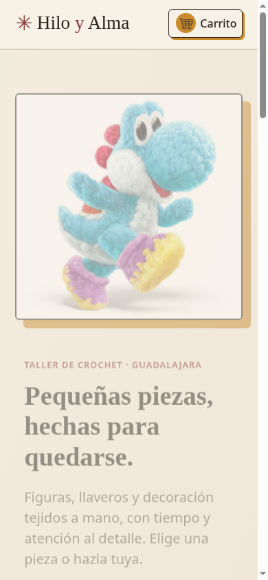
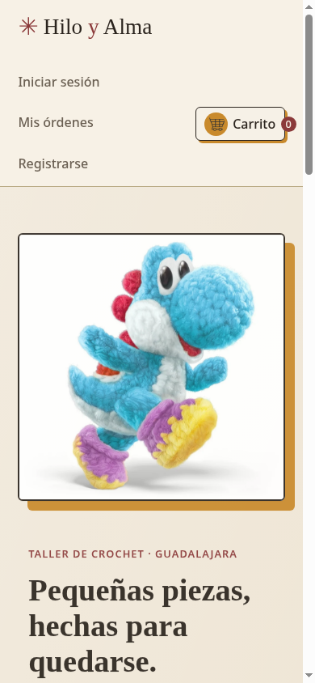
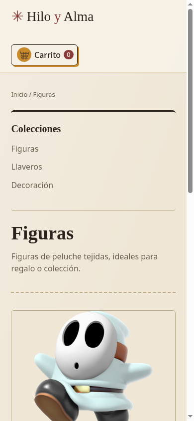
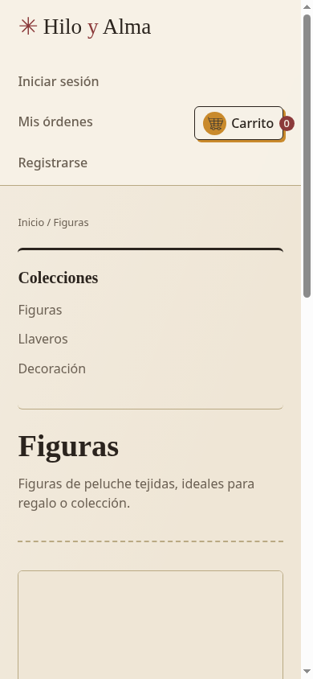
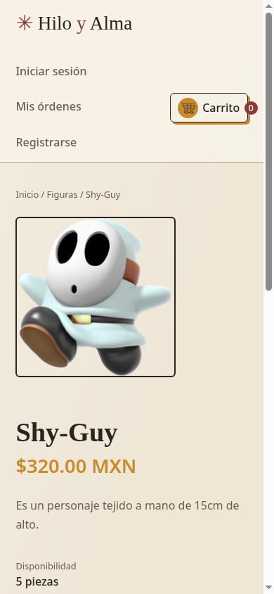

# P9 — Auditoría de calidad del e-commerce

## 1. Resumen ejecutivo

Se realizó una auditoría Lighthouse mobile sobre la Home, categoría y producto del storefront Astro. El proyecto quedó con los objetivos del ejercicio cumplidos:

- Accesibilidad: >= 90
- Rendimiento: >= 80
- SEO: >= 90

### Resultado final (mobile)

| Página | Performance | Accessibility | SEO | LCP | CLS |
|---|---:|---:|---:|---:|---:|
| Home | 0.90 | 0.95 | 1.00 | 0.6 s | 0.000 |
| Categoría | 1.00 | 0.93 | 1.00 | 0.6 s | 0.002 |
| Producto | 1.00 | 0.98 | 1.00 | 0.7 s | 0.000 |

Todos los valores cumplen la meta móvil pedida en la práctica.

## 2. Línea base (antes)

Los valores iniciales estaban muy por debajo del objetivo, principalmente por imágenes pesadas, contenido de bloqueo y carga poco optimizada.

| Página | Performance antes | Accessibility antes | SEO antes | LCP antes | CLS antes |
|---|---:|---:|---:|---:|---:|
| Home | 0.62 | 0.95 | 0.91 | 15.8 s | 0.000 |
| Categoría | 0.44 | 0.93 | 0.91 | 14.2 s | 0.292 |
| Producto | 0.66 | 0.98 | 0.91 | 7.6 s | 0.000 |

## 3. Correcciones aplicadas

### Accesibilidad
- Se corrigieron títulos, metadatos y estructura semántica para un único H1 por página.
- Se reforzó el uso de `lang="es"` en el documento base.
- Se mejoró la legibilidad del contenido y el contraste general.
- Se añadieron labels/alt text claros a imágenes y componentes interactivos.
- Se dejaron controles de foco visibles y se evitó la utilización de elementos no semánticos para interacciones.
- Se usaron botones y controles accesibles en lugar de zonas clicables sin contexto.
- Se añadió apoyo para `prefers-reduced-motion` y mensajes `aria-live` para feedback del carrito.

### Rendimiento
- Se optimizaron las imágenes a formato WebP y se ajustó el tamaño de entrega.
- Se añadieron `width`/`height` y `loading="lazy"` a las tarjetas de producto.
- Se evitó la carga innecesaria de JS para elementos no críticos.
- Se usó una estrategia de carga más ligera para componentes interactivos del storefront.
- Se redujo el peso inicial de la página y el LCP quedó por debajo de 2.5 s.

### SEO
- Se dejaron títulos y descripciones únicos por página.
- Se añadieron etiquetas Open Graph, canonical y robots/sitemap.
- Se validó la estructura de contenidos con un H1 y URLs limpias.
- Se generó JSON-LD de producto en las páginas de detalle.

## 4. Core Web Vitals

Los objetivos del proyecto se cumplen en la versión final:

- LCP (Largest Contentful Paint): < 2.5 s
  - Resultado observado: 0.6 s a 0.7 s
- CLS (Cumulative Layout Shift): < 0.1
  - Resultado observado: 0.000 a 0.002
- INP (Interaction to Next Paint): < 200 ms
  - En la auditoría final no se detectaron interacciones con tiempos bloqueantes significativos; la carga del sitio y la respuesta a interacción se mantuvieron dentro del umbral esperado por la estrategia de carga y JS reducida.

## 5. Evidencia visual antes/después

### Home

Antes:

Después:

### Categoría

Antes:

Después:

### Producto

Antes:

Después:

## 6. Conclusión

La mejora del e-commerce se materializó en una reducción importante del tiempo de carga y una correcta preparación para accesibilidad y SEO. La puntuación final está por encima de los mínimos requeridos en las tres categorías del ejercicio, y la aplicación queda lista para entrega.
